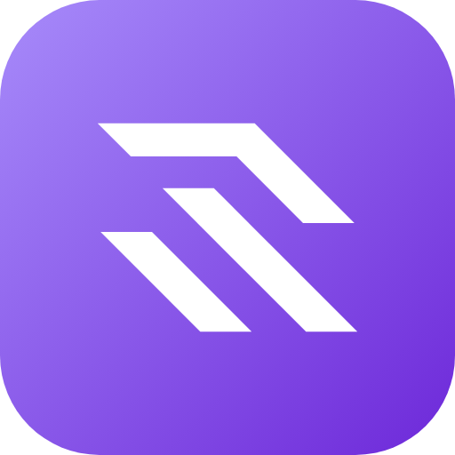
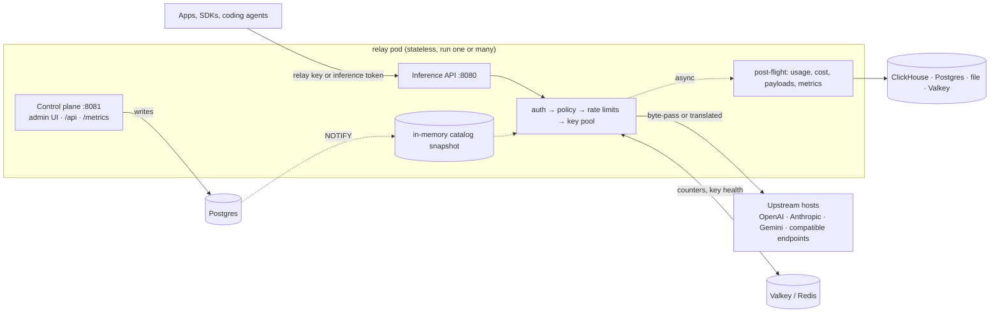

<div align="center">
  

  <h1>Wyolet Relay</h1>

  <p>Self-hosted LLM gateway: one OpenAI- and Anthropic-compatible endpoint in front of your provider keys, with key pooling, policies, rate limits and per-request cost.</p>

  <p>
    <a href="https://github.com/wyolet/relay/actions/workflows/ci.yml?query=branch%3Amain"></a>
    <a href="https://github.com/wyolet/relay/releases/latest"></a>
    <a href="LICENSE"></a>
    <a href="https://hub.docker.com/r/wyolet/relay"></a>
    <a href="https://pkg.go.dev/github.com/wyolet/relay/sdk"></a>
  </p>

  <p>
    <a href="https://docs.wyolet.com/quickstart"><strong>Quickstart</strong></a> ·
    <a href="https://docs.wyolet.com">Docs</a> ·
    <a href="https://discord.gg/KUhJ8X3w">Discord</a>
  </p>
</div>

---

Relay is a single Go binary with two listeners: the inference API on `:8080` and the control plane (admin UI, control API under `/api`, Prometheus metrics) on `:8081`. Applications keep their OpenAI or Anthropic SDK and change the base URL. For each request, relay authenticates the relay key, applies the policy that governs it, reserves rate-limit capacity, picks a healthy host key from the pool and streams the response back. When the caller's wire shape and the upstream's differ, relay translates between them; when they match, it passes the bytes through. Relay is Apache-2.0, runs on your infrastructure with your own provider keys, and sends no telemetry.

**Scope.** Relay is infrastructure: routing, keys, limits and accounting. It does not resell tokens and does not pick models for you based on quality. Clients need no relay-specific protocol: OpenAI and Anthropic request shapes are accepted as they are.

## Quickstart

1. Start relay with its bundled Postgres and model catalog:

   ```bash
   docker run -p 8080:8080 -p 8081:8081 wyolet/relay:standalone
   ```

   Add `-v relay-data:/var/lib/postgresql/data` to keep data, credentials and the generated master key across restarts.

2. Open http://localhost:8081 and sign in as `admin` with the password printed in the container logs on first boot. The setup wizard adds a provider key (an OpenAI key for the examples below) and creates a relay key. The relay key is shown once, so copy it.

3. Send an OpenAI Chat Completions request:

   ```bash
   curl http://localhost:8080/openai/v1/chat/completions \
     -H "Authorization: Bearer <your-relay-key>" \
     -H "Content-Type: application/json" \
     -d '{"model":"gpt-4o","messages":[{"role":"user","content":"hello"}]}'
   ```

   Send the same model an Anthropic Messages request. Relay translates the request for the OpenAI upstream and returns the answer in the Anthropic shape:

   ```bash
   curl http://localhost:8080/anthropic/v1/messages \
     -H "x-api-key: <your-relay-key>" \
     -H "Content-Type: application/json" \
     -d '{"model":"gpt-4o","max_tokens":256,"messages":[{"role":"user","content":"hello"}]}'
   ```

Other ways to run it:

- **Docker Compose**: the lean image with its own Postgres and Valkey ([`docker-compose.yml`](docker-compose.yml), [docs](https://docs.wyolet.com/deploy/docker)).
- **Kubernetes**: `helm upgrade --install relay oci://ghcr.io/wyolet/charts/relay --version <version>` ([chart README](chart/README.md), [docs](https://docs.wyolet.com/deploy/kubernetes)).

### Already using an SDK?

Point it at relay and pass the relay key where it expects its API key.

| Client | Setting |
|---|---|
| [OpenAI SDKs](https://docs.wyolet.com/clients) | `base_url = "http://localhost:8080/openai/v1"` |
| [Anthropic SDKs](https://docs.wyolet.com/clients) | `base_url = "http://localhost:8080/anthropic"` |
| [Claude Code](https://docs.wyolet.com/claude-code) | `ANTHROPIC_BASE_URL=http://localhost:8080/claude-code` |
| [Codex CLI](https://docs.wyolet.com/codex) | `base_url = "http://127.0.0.1:8080/codex/v1"` |
| [OpenCode](https://docs.wyolet.com/opencode) | `"baseURL": "http://localhost:8080/opencode/v1"` |
| [Go SDK](https://docs.wyolet.com/go-sdk) | `WR_BASE_URL=http://localhost:8080`, `WR_API_KEY=<relay key>` |

## How it works



- The inference path makes no Postgres calls. Routing reads an in-memory snapshot of the catalog, keys and policies; every pod updates it from a Postgres NOTIFY within about a second of a control-plane write.
- Rate-limit counters and key health live in Valkey or Redis, shared by all pods. A single pod can keep them in memory instead.
- Failover runs across the host keys of the chosen host and only before the first byte. Once bytes reach the caller, relay does not retry.
- Usage, cost, payload and metric records are emitted after the response, on bounded queues that never block the caller. If a queue is full the record is dropped and counted in `relay_records_lost_total`.
- When the caller's shape matches the upstream's, the body is passed through unchanged. Otherwise relay translates it, one SSE event at a time for streams, through a vendor-neutral canonical protocol (`sdk/v1`).
- The `relay_overhead_seconds` histogram measures relay's own time per request (total handler time minus the upstream call), so you can see what relay adds in your deployment.

More in [Architecture](https://docs.wyolet.com/concepts/architecture).

## Features

### Routing and keys

- **Wire shapes.** Inbound: OpenAI Chat Completions, Responses and Embeddings; Anthropic Messages; relay's canonical `/v1/generate`; a multiplexed WebSocket at `/v1/ws`. Upstream: OpenAI (Chat Completions, Responses, Embeddings), Anthropic Messages and Gemini `generateContent`. [Inference API](https://docs.wyolet.com/reference/inference-api)
- **Hosts.** The bundled catalog includes OpenAI, Anthropic, Google Gemini, Mistral, xAI, Alibaba, Moonshot AI, Z.ai, MiniMax and Ollama Cloud, among others. Any OpenAI- or Anthropic-compatible endpoint, including a self-hosted Ollama, can be added as a host. [Catalog](https://docs.wyolet.com/concepts/catalog)
- **Key pools.** A policy lists the host keys its traffic may use. Relay picks one with `prioritized`, `round-robin` or `least-recently-used`, keeps a circuit breaker per key, and moves to the next key when one fails. A rotated key starts with a fresh breaker. [Key pooling](https://docs.wyolet.com/concepts/key-pooling)
- **Recovery on auth failure.** When a host key returns 401, relay re-reads its value from the env var or stored secret and either retries or fails over while it heals in the background. [Key pooling](https://docs.wyolet.com/concepts/key-pooling)
- **Rate limits.** Rules count `requests`, `concurrency`, `tokens` or a single token class such as input, output, cache reads, cache writes or reasoning. Strategies are token bucket, sliding window, fixed window, leaky bucket and session window. Limits attach to a policy, shared by the credentials it governs within a team, and to host keys, to stay inside each upstream account's limits. [Rate limits](https://docs.wyolet.com/concepts/rate-limits)
- **Load shedding.** A per-pod in-flight cap (`RELAY_MAX_INFLIGHT`) answers overflow with `503` (`529` on Anthropic-shaped routes) and `Retry-After` before it reads the body. [Configuration](https://docs.wyolet.com/configuration)

### Access and tenancy

- **Relay keys and inference tokens.** Relay keys are stored as hashes and shown once, and they support expiry, revocation and rotation with a grace period. Inference tokens are short-lived, Ed25519-signed and minted at `POST /api/auth/token`. Callers never see the host keys. [Authentication](https://docs.wyolet.com/concepts/auth)
- **Policies.** A policy grants the models and hosts a credential may reach and names the host keys that serve it, how a key is picked and which rate limits apply. [Policies](https://docs.wyolet.com/concepts/policies)
- **Tenancy and RBAC.** Teams, projects, service accounts, users and groups. With `RELAY_AUTHZ=rbac` you get seven built-in roles, bindings at system, team or project scope, and access review (`relay auth can-i`). [Authentication](https://docs.wyolet.com/concepts/auth)
- **SSO and provisioning.** OIDC login with any provider that publishes a discovery document, and SCIM 2.0 provisioning of users and groups. [SSO](https://docs.wyolet.com/concepts/sso) · [SCIM](https://docs.wyolet.com/concepts/scim)
- **Audit log.** Control-plane changes are recorded and can be read at `GET /api/audit`. [Audit](https://docs.wyolet.com/concepts/audit)

### Observability and cost

- **Usage and cost.** Each request produces one usage record. Token counts come from the provider's response, and cost comes from the catalog pricing of the binding that served it. Records go to ClickHouse, Postgres, a JSONL file or Valkey, and you query them at `/api/usage/*`. [Usage](https://docs.wyolet.com/concepts/usage)
- **Payload logging.** Request and response bodies are captured only when enabled both globally and on the governing policy. They are stored in ClickHouse, S3 or a file, and the ClickHouse store has an erase API. [Payload logging](https://docs.wyolet.com/concepts/payload-logging)
- **OTLP receiver.** Applications that call providers directly can report those calls over OTLP/HTTP (`/otlp/v1/traces`, `/otlp/v1/logs`) and get the same usage and cost records. Off by default. [OTLP receiver](https://docs.wyolet.com/concepts/otlp-receiver)
- **Metrics.** Prometheus `/metrics` on the control listener. The Helm chart ships two Grafana dashboards. [Metrics](https://docs.wyolet.com/reference/metrics)

### Operations

- **GitOps.** `relay apply -f` plans with `--dry-run` and deletes omitted rows with `--prune --selector`. `relay export` renders the current state, and every manifest kind has a published JSON Schema. [GitOps](https://docs.wyolet.com/concepts/gitops)
- **Secrets.** A host key either references an env var or is stored sealed with XAES-256-GCM under a per-owner data key wrapped by `RELAY_MASTER_KEY`. `relay secret` rotates data keys and re-wraps them under a new master key. [Secret keys](https://docs.wyolet.com/concepts/secret-keys)
- **Kubernetes.** The Helm chart includes a pre-upgrade migration Job, HPA, PDB, NetworkPolicy, ServiceMonitor, Ingress or Gateway API route, and bundled Postgres, ClickHouse and Valkey, each of which can be replaced by an external store. [Chart README](chart/README.md) · [Kubernetes](https://docs.wyolet.com/deploy/kubernetes)
- **Catalog.** Provider, model and pricing data come from the open [relay-catalog](https://github.com/wyolet/relay-catalog) repo and are bundled in the image. Pin `RELAY_CATALOG_VERSION` to upgrade the catalog, keep local edits as overlays that survive upgrades, and serve releases from your own `catalog-server`. [Catalog](https://docs.wyolet.com/concepts/catalog) · [Overlays](https://docs.wyolet.com/concepts/overlays) · [Catalog server](https://docs.wyolet.com/reference/catalog-server)

### Also included

| Feature | Docs |
|---|---|
| Async batch API `/v1/batches`: submit, poll, fetch results, cancel; items go through the same policy, rate-limit and key-pool path as realtime traffic | [Batch](https://docs.wyolet.com/batch) |
| Claude Code gateway: `/claude-code` prefix, model discovery, token counting | [Claude Code](https://docs.wyolet.com/claude-code) |
| Codex CLI gateway (`/codex`) and OpenCode gateway (`/opencode`) | [Codex](https://docs.wyolet.com/codex) · [OpenCode](https://docs.wyolet.com/opencode) |
| Go SDK with proxy, telemetry and direct modes | [Go SDK](https://docs.wyolet.com/go-sdk) |
| Proxy mode: the caller's own upstream key, body forwarded unchanged, usage and cost still recorded | [Proxy mode](https://docs.wyolet.com/concepts/proxy-mode) |
| Model aliases and catalog version pinning | [Catalog](https://docs.wyolet.com/concepts/catalog) |
| `X-WR-*` request and response headers | [Headers](https://docs.wyolet.com/reference/headers) |
| Control API: CRUD for every kind, settings, usage, logs | [Control API](https://docs.wyolet.com/reference/control-api) · [Settings](https://docs.wyolet.com/reference/settings) |
| `RELAY_*` environment variables | [Configuration](https://docs.wyolet.com/configuration) |
| `relay` CLI: migrate, seed, apply, export, token, auth, secret | [CLI](https://docs.wyolet.com/reference/cli) |
| Common errors and fixes | [Troubleshooting](https://docs.wyolet.com/troubleshooting) |

## Production readiness

- **Releases.** Releases are SemVer tags on `main`. A release runs only after the full CI suite has passed on the tagged commit. It publishes the lean image (`wyolet/relay`, needs external Postgres) and the standalone image (`wyolet/relay:standalone`) to Docker Hub and GHCR, and the Helm chart to `oci://ghcr.io/wyolet/charts/relay`.
- **Supply chain.** Each release image is scanned with Trivy, and the release fails on fixable HIGH or CRITICAL vulnerabilities. CycloneDX SBOMs are attached to the GitHub release. Every image carries a signed SLSA build provenance attestation and an SBOM attestation, which you can check with `gh attestation verify` ([SECURITY.md](SECURITY.md#verifying-releases)). CI on `main` runs `govulncheck` and a Trivy scan of dependencies, configuration and secrets, and repeats both weekly.
- **Upgrades.** The Helm chart runs migrations in a pre-upgrade Job; outside Kubernetes, relay migrates on boot. Procedures and rollback are in [Upgrading](https://docs.wyolet.com/concepts/upgrade).
- **Network.** Relay sends no telemetry. The images bundle the catalog and fetch nothing unless `RELAY_CATALOG_VERSION` is set. When it is set, relay downloads catalog releases from `catalog.wyolet.com` and checks their sha256; `RELAY_CATALOG_URL` and `RELAY_CATALOG_INDEX_URL` point it at your own `catalog-server`. A binary built with `make build` pins a catalog version by default when `RELAY_CATALOG_DIR` is unset.
- **Licensing.** All code is Apache-2.0. One feature, authoring custom RBAC roles, needs a license file, which is verified offline against a key compiled into the binary. OIDC, SCIM, audit and everything else work without one. [License](https://docs.wyolet.com/concepts/license)
- **Images.** Published images are `linux/amd64` only.
- **Security.** Private reporting, response times, scope and the deployment trust model are in [SECURITY.md](SECURITY.md).

## Repository

| Module | Import path | Contents |
|---|---|---|
| server | `github.com/wyolet/relay` | the `relay` binary and its tools |
| [SDK](sdk/README.md) | `github.com/wyolet/relay/sdk` | Go client, canonical protocol, vendor translators, embedded catalog with cost lookup |
| [jobq](jobq/README.md) | `github.com/wyolet/relay/jobq` | Postgres-backed durable job queue |
| [auth](auth/README.md) | `github.com/wyolet/relay/auth` | authentication and authorization primitives: OIDC, SCIM, RBAC, sessions, signed tokens |
| [secret](secret/README.md) | `github.com/wyolet/relay/secret` | secret references, sealed format, per-scope key ring |

The standalone modules import nothing from the server module. Build, test and PR workflow are in [CONTRIBUTING.md](CONTRIBUTING.md).

## Contributing

Issues and pull requests are welcome. See [CONTRIBUTING.md](CONTRIBUTING.md).

## Security

Report vulnerabilities privately, as described in [SECURITY.md](SECURITY.md). Do not open a public issue.

## Commercial support

For managed hosting, enterprise builds or priority support, contact [business@wyolet.com](mailto:business@wyolet.com).

## Community

[Discord](https://discord.gg/KUhJ8X3w) · [X](https://x.com/wyolethq) · [LinkedIn](https://www.linkedin.com/company/wyolet) · [Bluesky](https://bsky.app/profile/wyolet.bsky.social) · [Reddit](https://www.reddit.com/r/wyolet)

## License

[Apache-2.0](LICENSE).
